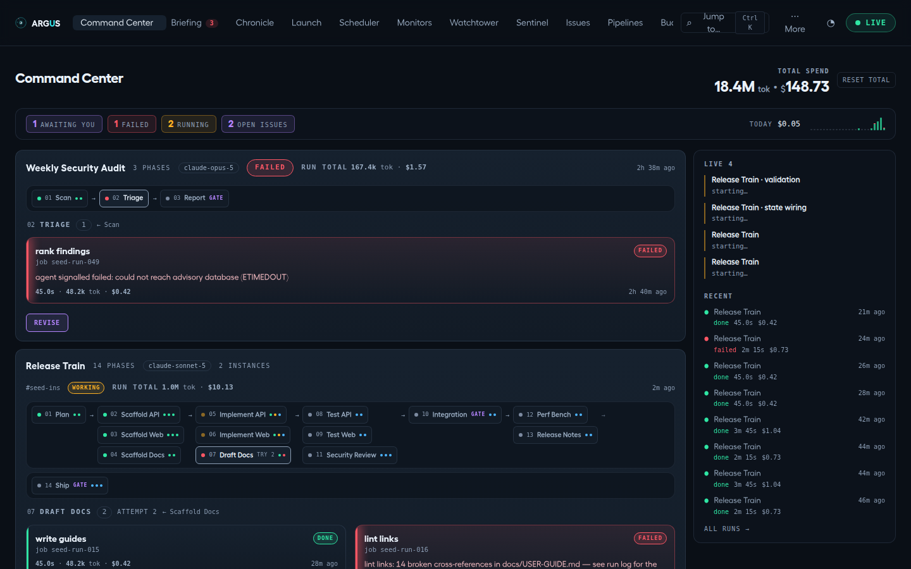
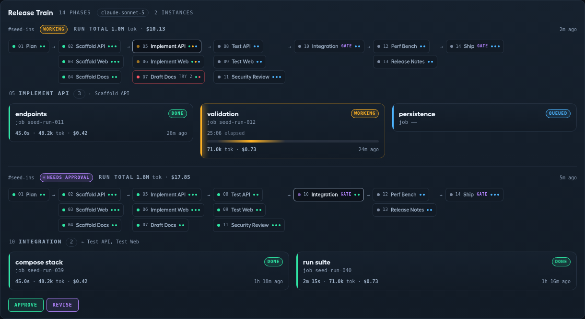
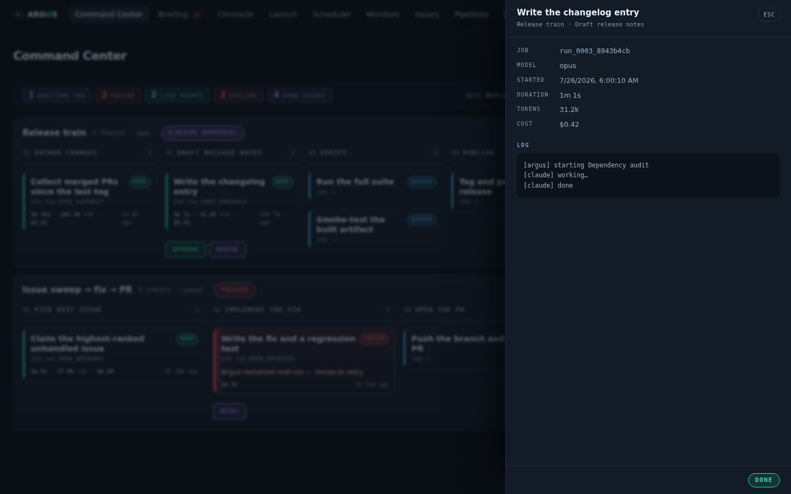
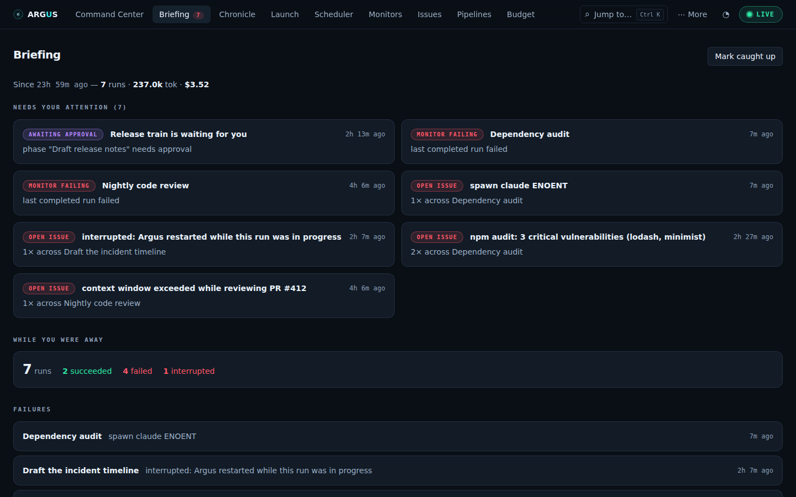
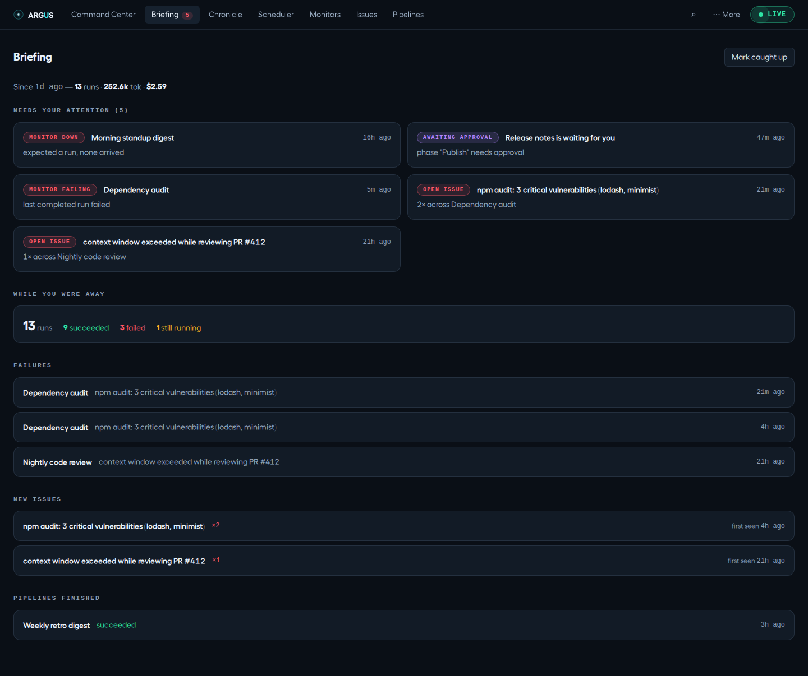
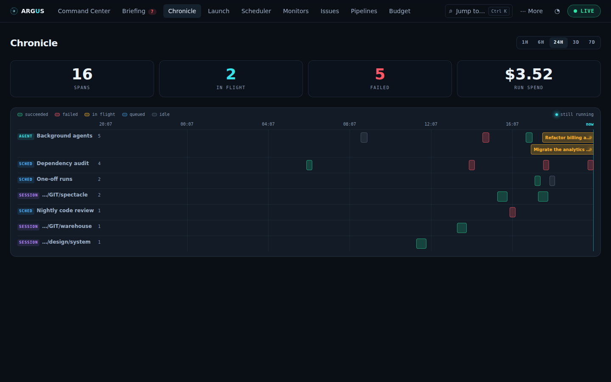
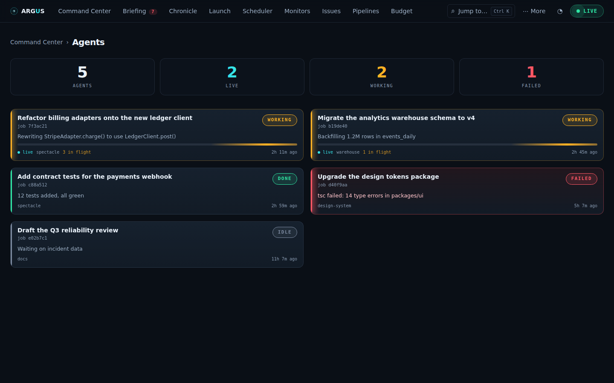
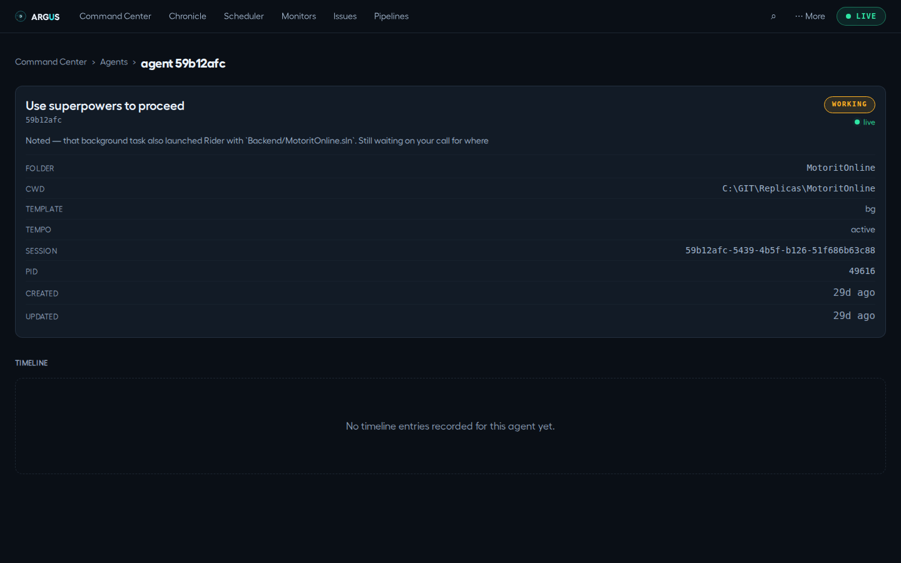

# Monitor runs and review recent work

[Documentation](../README.md) · [Feature guides](../guides/README.md)

See what is running, what needs attention, and the evidence behind a run.

## Before you start

At least one pipeline, schedule or one-off run for run history. The Agents page describes discovered CLI background jobs, not every Argus run.

## Try it

1. Open **Briefing** to review waiting gates, failures and other attention items.
2. Open **Command Center** for pipeline progress; select a phase or step for detail.
3. Open a run link to reach its **Flight Recorder**, then compare activity, final output and exit state.
4. Open **Chronicle** and choose a time window to compare runs with CLI sessions.
5. Mark the Briefing caught up only after reviewing what matters to you. This moves your digest checkpoint.

**Expected result:** You can trace an attention item to its source run and know whether it is running, waiting or settled.

## On this page

- [Command Center](#command-center)
- [Briefing](#briefing)
- [Chronicle](#chronicle)
- [Agents](#agents)
- [Agent Detail](#agent-detail)
- [Flight Recorder](#flight-recorder)

## Command Center

_Pipelines at a glance — the home tab._ Route: `#/command`

**Purpose:** one card per pipeline, attention-first, with a **phase graph**
drawing the whole pipeline's shape and a **focus panel** beside it showing one
phase's step tiles at a time. Everything waiting on you is listed above the
board under **Needs you**, each with a **Review** button that opens the review
drawer — this is the wall you keep open on a second monitor.

**What you see:**

- A **situation strip** across the top, answering "does anything need me?"
  without reading the board. On the left, what asks something of you: gates
  that need approval, failed pipelines, down/failing monitors, open issues and
  anomalies — each a link to the view that explains it, and **N need approval**
  (**1 needs approval**) / **N pipelines failed** open the first such review
  directly. Beside them, the machine at work: runs
  in flight and live agents. It shows **only what is true**: a metric with
  nothing to report is omitted rather than drawn as a grey zero, and when
  nothing is asked of you it says **Nothing needs you** — even while runs are
  in flight. On the right: the next scheduled firing with a live countdown,
  today's spend against your daily limit as a bar, and a 24-hour histogram of
  run outcomes (failures stacked in red over successes).
- **Needs you**, when anything does: one line per gate waiting for approval
  (first) and per phase that failed, each naming the pipeline and phase, then
  **Needs approval** or the failure reason (**This phase failed** when there is
  none), and one **Review** button into the same drawer the card opens — a
  revise or retry is chosen in there. Its header tallies the list in the
  strip's words: `2 need approval · 1 failed · 3 outside pipelines`. A card
  shows one phase at a time, so this is where a second gate in a fan-out, or a
  gate on a card further down, is never missed.
  Below them, under **Outside pipelines**, come the Briefing's items the board
  has no card for — **Monitor down**, **Monitor failing**, **Anomaly** and
  **Open issue** — each with the same action the Briefing gives it (**Open
  monitor**, **Inspect run**, **Triage issue**). An open issue raised by a
  down or failing monitor's schedule alone is folded into that monitor's row,
  which then names the error and its count, rather than listed a second time.
  Four are listed; the rest are a **+N more in the Briefing** link. It draws
  nothing when nothing is waiting.
- A **live activity rail** down the right: **Live** shows what is running right
  now, including scheduled runs and one-off launches that have no card on the board. Pipeline steps can show current tool activity; batch schedule/one-off invocations do not provide the same per-tool stream. **Recent** lists the last
  completed runs with outcome, duration and cost; a firing skipped by its
  overlap policy or the budget reads **Skipped**. Every row opens that run's
  [Flight Recorder](#flight-recorder), and **All runs** at the foot of the rail
  opens the [Chronicle](#chronicle). From about 1024px wide the rail sits
  beside the board and stays in view as you scroll; on a narrower screen it
  moves below the board. It shows on an empty board too, so a scheduled run or
  one-off launch is visible before any pipeline exists.
- A **card per pipeline**: name, an aggregated **status pill** (`Needs
approval` wins over `Failed` over `Working`…), then quieter facts — phase
  count, the pipeline's **model** (e.g. `fable`, `opus`), the latest run's
  **run total** (tokens + USD, including superseded revise attempts), and a
  freshness stamp. A card waiting on you carries a violet wash along its top
  edge; a failed one, red.
- Under the header, the **phase graph**: one numbered node per phase carrying
  its status dot, name, a **Gate** marker, a **Try N** marker after a retry or
  revise, and one mini-dot per step (a `done/total` count once dots stop being
  countable). **Stages** — phases that can run at the same time — are rows,
  read top to bottom; the chain that continues stays in the left lane and
  branches that end the run hang to its right. When the stages are too wide
  for the card (a fan-out of many parallel phases), the graph turns sideways:
  stages become columns read left to right, and the parallel phases stack as
  one column. An edge that skips a stage runs down a lane of its own, so it
  never crosses a node. Every dependency is a drawn
  edge, so a fan-out reads as a fan-out and a join as a join: the path that
  ran is the green thread, a branch that was decided against is dashed, and a
  phase nothing depends on ends with a small terminator. A **route
  condition** sits as a label on the edge it governs, carrying the value
  alone (`verdict = "approved"`) — the phase that decides it is the line the
  label sits on. A skipped phase shows a hollow dot, a struck name and a
  **Skipped** marker.
  Hovering a node shows its full name, what the phase waits for and the
  conditions on it.
  The graph is scaled to fit the width of its tile (down to 82%, so its
  smallest text stays legible) and scrolls in both directions beyond that. It
  **follows the run**: the view scrolls only as far as it takes to show the
  running phases, with the phase after them when there is room, and glides on
  as the run moves — the first and last phase can still be centred. Scrolling the graph yourself, or clicking a node, stops following.
  The graph's view controls sit in a row of their own above it, so they never
  cover a node: **Follow**, there whenever the graph scrolls, shows pressed
  while the view follows and switches following on or off; **Full size**,
  there when the graph is scaled down, shows it at full size and **Fit** goes
  back. Edges with more graph beyond them fade out.
- Beside the graph (below it on a narrow card), the **focus panel**: one
  phase's **step tiles** — step name, `job <runId>`, a status pill, the
  failure reason if it failed, a live activity line and animated sweep bar
  while working, and a per-step meter — duration, tokens, dollars (e.g.
  `2m 19s · 23.5k tok · $1.09`). Click anywhere on a tile to open its step
  drawer. When the phase in focus is the one waiting on you (or the one that
  failed), a callout with its **Review** button leads the panel, above
  the tiles. Under its header, one line names what the phase waits for (behind
  an arrow pointing back) and another where its routes lead (behind an arrow
  pointing on): each phase by number and name, with a conditional edge's
  condition in the same chip the graph draws on that edge, and **or skipped**
  where a join accepts a branch that never ran. By
  default the focus **follows the action** — the gate awaiting you, else the
  failure, else the live work, else the next phase up — so an untouched board
  always shows the detail that matters right now.
- If two instances of one pipeline run concurrently, the card splits into
  labeled sub-sections, one per instance, each with its own graph and focus.
- **Completed runs** (top-right): the all-time board total — tokens and
  dollars across every completed run, so a run still going is not in it yet.
  The small reset button beside it (**Reset total**) opens a confirm below the
  figure — "Start the total again from zero? This can't be undone." — with
  **Cancel** focused, so a stray Enter keeps the total, and **Confirm reset**
  beside it; Escape or **Cancel** closes it. While the total is zero there is
  nothing to reset, and the button is not shown.
  **Launch a task** beside it is the page's primary action: it opens the
  Scheduler's one-off form.
- **Before any pipeline exists**, the board shows the iris and three ways to
  start: **Launch a task**, **New schedule** and **Build a pipeline**. There
  the board's own **Launch a task** is the primary action, and the header's
  becomes a secondary button.
- **When the board doesn't load** and nothing was loaded before, a strip says
  why (see [Global UI](navigation.md#global-ui)) with **Retry**, and the board's
  place reads **The board didn't load** instead of the first-run board — so a
  failed request never looks like your pipelines are gone. **Needs you** still
  lists the Briefing's items, marked as partial: "Pipeline gates and failures
  are missing until the board loads." The activity rail keeps showing runs,
  since it has its own request.

**What you can do:**

- **Review** a gated phase that's awaiting you. The button opens the **review
  drawer**: the agent's closing note, the phase's structured result and Argus's
  own checks when it declared any, and every file the phase left in its
  artifact directory. The closing note renders as a document (it is the
  agent's last message, which is markdown); on a failed phase the one-line
  reason sits above it, and the rest of what the runtime handed the Stop hook
  — session id, transcript path, background tasks and the like — waits behind
  a **Raw payload** toggle. A `.md` artifact renders as a document; any other
  text file shows raw; a binary shows its size. The file a check required is badged
  **Required** and opens first. `⌘K` → "review" reaches the same drawer
  without finding the card first, and `#/command/<instanceId>` deep-links to
  it — that is the link `argus tail` prints beside a waiting gate.
- **Approve** (green, in the drawer) continues the pipeline with exactly what
  is shown. **Revise** (labeled **Retry** after a crash-restart) asks for a
  note — your revision — and **Send** restarts the phase with it appended to
  the agent's prompt; that attempt's files are discarded. Nothing in the drawer
  edits an artifact: the note is how you change the outcome. Approve and Revise
  live in the drawer and nowhere else on the board.
- Both actions require a signed-in, approved account (see
  [Users & sign-in](administration.md#users--sign-in)); looking is open to everyone, and the
  server answers 401 to a decision unless you're authenticated. From a terminal,
  `argus approve` / `argus revise` do the same (see [`argus tail`](terminal.md#argus-tail)).
- **Click a phase node** to pin that phase's steps into the focus panel —
  every step of every phase is one click away; the edges into and out of the
  pinned node light up; click it again to return to following the action.

_A pinned phase: the graph keeps the whole pipeline ambient while the focus
panel shows the steps being asked about._

- **Click a step's name** to open its drawer, over the board rather than away
  from it: the run id, model, start time, duration, tokens, cost, the failure
  reason if it failed, a link to the transcript, **Cancel run** while it is
  still going, and the run log — tailing live while the step works.
- A tile that has just changed status flashes briefly, so a transition you
  weren't watching for doesn't pass unnoticed.

_A step's drawer opens over the board, so inspecting one run doesn't cost you the
view of the other eleven._

**Cost semantics:** a metric appears once at least one run reports it via the
runtime's result envelope; steps still running (or predating cost capture)
show nothing. Money spent on a retried phase still counts toward the row Σ.

**Where the data comes from:** `GET /api/overview` (re-fetched on the
`pipelines:changed` WS ping), `GET /api/insight` for the situation strip,
`GET /api/runs` for the rail, `GET /api/runs/:id` for the drawer's log,
`GET /api/totals` + `POST /api/totals/reset`, gate actions
`POST /api/instances/:id/approve` / `/revise`, and
`POST /api/runs/:id/cancel`.

## Briefing

_The "while you were away" digest — read this first after time away._
Route: `#/briefing`

**Purpose:** Argus exists so agents can run unattended — which means you're
usually not looking when things happen. The Briefing answers the two questions
you'd otherwise tour four tabs for: **what needs me right now**, and **what
happened since I last caught up**.

**The attention badge:** the Briefing tab shows a violet count chip in the nav
bar whenever something needs you (visible from any tab). The count is the
number of attention cards below.

**Needs your attention** — state-now cards, most severe first, each
deep-linking to where you act on it. The Command Center's **Needs you** list
uses the same names and actions:

- **Needs approval** (**Review gate** → the Command Center's review drawer
  for that instance): a gated pipeline phase is paused waiting for you to
  review it.
- **Monitor down** (**Open monitor** → Health): a schedule's expected run
  never arrived — the dead-man's switch fired.
- **Monitor failing** (**Open monitor** → Health): the schedule runs, but its
  last completed run failed.
- **Anomaly** (**Inspect run** → that run's Flight Recorder): a critical
  [Watchtower](health-and-quality.md#watchtower) anomaly.
- **Open issue** (**Triage issue** → Issues): an unresolved failure group,
  with its occurrence count and affected schedules.

**While you were away** — everything below is scoped to the window since your
last acknowledgement (or the last 24 h if you've never acknowledged; capped at
7 days):

- The header line totals the window: **runs · tokens · cost**.
- A run-outcome strip: succeeded / failed / interrupted / cancelled / skipped
  / still running counts.
- **Failures** — the windowed failed runs (schedule, first error line, when),
  newest first.
- **New issues** — failure groups whose _first_ occurrence is inside the
  window, i.e. genuinely new breakage, not an old known issue recurring.
- **Pipelines finished** — instances that reached a terminal state in the
  window.

**Mark caught up** (top right): stamps now as your acknowledgement point and
resets the window — the digest empties, and tomorrow's briefing starts from
this moment. Attention cards are unaffected (a down monitor stays down until
it actually recovers). The acknowledgement is stored in Argus-owned
`~/.claude/argus/briefing.json`.

**All caught up:** when nothing needs attention and nothing ran in the
window, the tab says so and gets out of the way.

**Where the data comes from:** `GET /api/briefing` (a pure derivation over
runs + schedules + issue triage + pipeline instances; re-fetched on the
`schedules:changed`, `pipelines:changed`, `issues:changed` and
`briefing:changed` WS pings), `POST /api/briefing/ack`.

## Chronicle

_Everything that ran, on one timeline._ Route: `#/chronicle`

**Purpose:** a swimlane timeline that merges **scheduler runs**, **background
agents**, and **sessions** into a single windowed view — see a day of activity
in one glance, spot overlaps, and click into anything.

**What you see:**

- A **time-window switch** (top-right): **1h / 6h / 24h / 3d / 7d**, plus
  **90d** and **1y** from the [Vault](budget-and-history.md#the-vault)
  (default 24h). This is the zoom — there's no free pan; the window always
  ends at **Now** (marked on the right edge of the axis). The axis is marked
  at round times for the window — every few hours on a day, midnights on a
  week, months on a year — rather than at even fractions of it.
- Four counters: **Runs**, **In flight** (still running), **Failed**, and
  **Run spend** (USD reported by scheduler runs in the window).
- A key above the timeline: **Run status** (Succeeded, Failed, Still running,
  Queued, Stopped — interrupted or cancelled before it finished — and Idle)
  and **Lane kind**.
- One **swimlane per group**, labeled with a neutral icon chip for its kind —
  Schedule (a schedule's runs), Agent (background agents), Session (one lane
  per project) — followed by rows of **span bars** colored by status. A bar
  wide enough to carry a word is labeled. Still-running spans render
  open-ended with a pulsing dot at **Now**. Hover a bar for label,
  start→end, status and cost.
- Empty state: **Nothing happened in this window** — "Schedule runs, agents
  and sessions land here the moment they start" — with **Widen to …** (the
  next window up) and **Launch a task**.

**What you can do:** switch the window; click a span to jump to its source
(e.g. a schedule's card in the Scheduler).

**Where the data comes from:** `GET /api/chronicle?hours=N` (1–336), merging
the scheduler's run records with `~/.claude/jobs/` and
`~/.claude/projects/*/​*.jsonl`.

## Agents

_The status board for background jobs._ Route: `#/agents`

**Purpose:** the at-a-glance board for all background Claude Code jobs.

**What you see:**

- Four counters — **Agents**, **Live**, **Working** and **Failed** — once
  there are agents to count.
- A grid of **agent cards**: name, short id, a color-coded status pill
  (**Working**, **Done**, **Failed**, **Stopped** for a job halted mid-work,
  **Idle** or **Queued**), a pulsing green
  **Live** dot if it's running right now, the current detail line, a result
  box when there's finished output, and a footer — folder, tempo, and
  last-update time.
- With no agents, **No background agents yet** and a **Launch a task**
  button. If the list cannot be loaded, a strip says so with **Retry** instead.

**How to use it:** scan colors to triage — green pulse = running now, red =
failed. **Click any card** to open that agent's [Detail](#agent-detail).

**Where the data comes from:** `GET /api/agents`, merging
`~/.claude/jobs/<short>/state.json` with `~/.claude/daemon/roster.json`
(an agent is "live" only if it's an active worker in the roster).

## Agent Detail

_Single-agent deep dive + timeline._ Route: `#/agent/<short>`

**Purpose:** everything about one agent, including the chronological trail of
how it got to its current state. A card click on Agents lands here.

**What you see:**

- A **metadata card**: name, short id, status pill, live dot, current
  detail/result text, and the full field list — folder, full CWD, template,
  tempo, session id, PID, task counts, and created/updated timestamps as
  relative times.
- A **timeline**: every recorded state transition, newest first, with a
  status-colored dot, pill, timestamp and optional detail line; long entries
  get a "Show details" expander. An entry that records progress rather than a
  change of state is headed **Update**, beside a hollow dot with no status
  color. Agents that predate timeline capture show an
  honest "no timeline entries recorded" note instead.

**How to use it:** read the timeline bottom-to-top to follow the agent's life
story. Use the breadcrumb to go back to Agents.

**Where the data comes from:** `GET /api/agents/:short/timeline`, reading
`~/.claude/jobs/<short>/timeline.jsonl`. Works even for agents no longer in
the main list.

## Flight Recorder

_Any run, replayed as a scrubbable timeline._ Route: `#/run/<runId>` (and
`#/run/<runId>/<ms>` for a specific moment)

**Purpose:** a transcript is a JSONL wall — thousands of lines where the one
that matters looks exactly like the ones that don't. The Flight Recorder is the
same information as a **recording**: every tool call, file diff, token burst
and cost tick placed on one time axis, with a playhead you can drag.

**How to get there:** expand any run row (Scheduler, Launch, Issues
occurrences) and select **Replay**; the Command Center's activity rail and the Briefing's failure rows link there too.

**What you see:**

- **Totals** — tool calls, file edits, errors, tokens, cost for the whole run.
- **Lane strips** — one density band per lane (Agent, Tools, Files,
  Tokens & cost) showing _where_ the activity was. Dense stretches read as
  solid; quiet stretches read as gaps. A vertical line marks the playhead.
- **The scrubber** — a range slider over the run's full duration. Its
  accessible value announces both the clock position and the event under the
  playhead.
- **The event list** — a 41-row window that follows the playhead. Click any
  row to seek to it.
- **The now panel** — the one event you are parked on, in full: the command,
  the message, the error body, the file path with `+added / −removed`, the
  token burst and running spend.

**What you can do:**

- **Play / pause** at 1×, 5×, 20× or 100×. Playback stops at the end rather
  than looping.
- **Step** to the previous/next event. A cluster of events sharing one instant
  is stepped over in one press, so the clock always moves.
- **Jump to failure** — on a failed run, lands on the _errored tool call_, not
  the terminal "it failed" marker. Keyboard: `f`.
- **Copy link to moment** — the URL carries the scrubber position, so a link
  to a recording is a link to minute four of it.
- Keyboard throughout: `space` play/pause, `←`/`→` step, `f` jump to failure.

**Honest limits, stated in the UI:**

- **Cost is apportioned, not measured.** The CLI reports one `total_cost_usd`
  for the whole run; per-event dollars are that figure split by token share.
  The view says so under the track.
- **Long runs are trimmed.** Past 2,000 events the earliest ones are dropped
  (the end of a run is where failures live). Offsets stay absolute, so the
  track simply starts partway in — and says that it did.
- **No transcript, no timeline.** A skipped run, a run with no session, or a
  pruned transcript gets an empty state that explains which of those it is.

**Where the data comes from:** `GET /api/runs/:id/recording`, derived on every
read from the run record plus `projects/<project>/<sessionId>.jsonl`. Nothing
is persisted — the transcript stays the source of truth.
